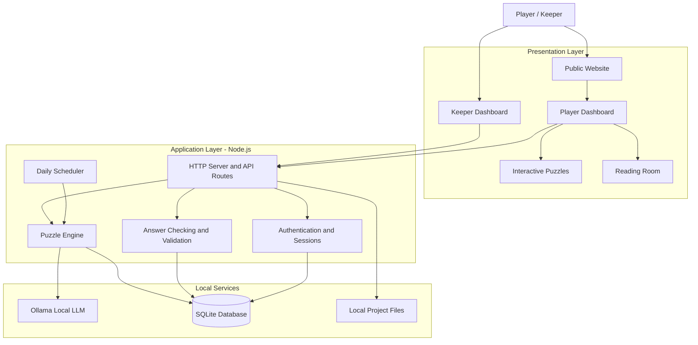
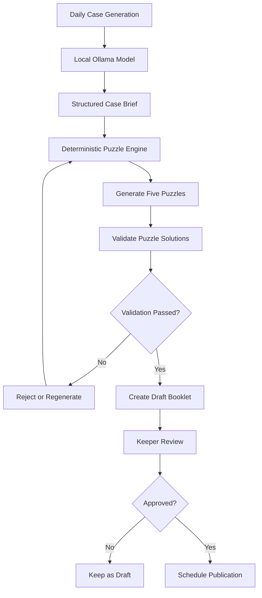
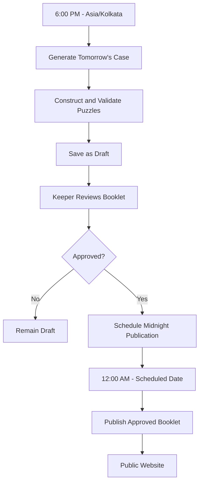

# 🕯️ Cozy Mystery Book — Daily Murder Mystery Puzzle

<p align="center">
  
  
  
  
  
</p>

<p align="center">
  <strong>One Day. Five Puzzles. One Murder to Solve.</strong>
  <br/><br/>
  A cozy daily murder-mystery experience where players investigate clues, solve logic puzzles, identify the culprit, and unlock an original mystery story.
</p>

<p align="center">
  <strong>🧩 Solve Mysteries</strong> &nbsp; • &nbsp;
  <strong>🔍 Investigate Clues</strong> &nbsp; • &nbsp;
  <strong>📖 Unlock Stories</strong> &nbsp; • &nbsp;
  <strong>🪴 Decorate Your Room</strong>
</p>

---

## 📖 Project Overview

**Cozy Mystery Book** is a locally operated daily murder-mystery puzzle platform that combines logical reasoning, interactive puzzles, storytelling, and personal room decoration.

Each daily booklet presents a new fictional murder case. Players work through five puzzle chapters to uncover important evidence, identify the killer, determine the motive and location, and solve the final accusation.

Successfully solving a case unlocks its reveal story and rewards players with coins that can be used to purchase decorations and customize their personal reading room.

The application also includes a private **Keeper Dashboard**, where the administrator can generate, inspect, test, edit, and approve upcoming daily booklets before publication.

### ✨ What Makes It Different?

- Five interconnected puzzle chapters per daily case.
- Locally generated mystery themes and stories using Ollama.
- Deterministic puzzle construction and answer validation.
- A private editorial approval workflow.
- Automated daily booklet generation and publication.
- Reward-based progression and reading-room customization.
- Complete local data ownership through SQLite.

## 🎮 Player Experience

Every daily booklet contains five puzzle chapters, each revealing a different part of the investigation.

### The Five Puzzle Chapters

| Chapter | Puzzle | Investigation Result |
|---|---|---|
| 01 | Word Search | Discover the motive |
| 02 | 6×6 Sudoku | Identify the location using the golden-square room code |
| 03 | Number Pattern | Determine the time |
| 04 | 5×5 Murdoku | Identify the killer |
| 05 | Hidden Objects | Find three garden objects and uncover weapon evidence |

### Interactive Puzzle Features

**Word Search**
- Search for themed vocabulary connected to the mystery.
- Discover the clues that reveal the motive.

**6×6 Sudoku**
- Solve a compact Sudoku puzzle.
- Use pencil notes.
- Undo previous moves.
- Reset the puzzle.
- Identify the location through the golden-square room code.

**Number Pattern**
- Analyze numerical sequences.
- Determine the missing time-related answer.

**5×5 Murdoku**
- Solve the killer-identification logic puzzle.
- Use placement notes.
- Track row and column exclusions.
- Undo moves and reset the puzzle.

**Hidden Objects**
- Find three objects hidden in a garden scene.
- Use the discovered objects to reveal weapon evidence.

### Final Accusation

After completing the investigation, players submit their final accusation.

The application checks the answers on the server side, including the killer, motive, location, and weapon.

<badge color="success">Correct accusation unlocks the story</badge>

A successful case closure reveals the complete mystery story and awards progression coins.

## 🪙 Rewards & Reading Room

Cozy Mystery Book combines puzzle-solving with a personal room-decoration experience.

### Reward System

- Earn coins by completing puzzles.
- Receive rewards for successfully closing a case.
- Spend coins in the decoration shop.
- Collect purchased decorations.
- Arrange owned items in a personal reading room.
- Save the room layout locally.

### Personalization Features

| Feature | Description |
|---|---|
| Coins | Earn in-game currency through puzzle progress |
| Decoration Shop | Purchase available room decorations |
| Item Collection | View owned decorations |
| Room Layout | Arrange decorations in a personal space |
| Saved Progress | Retain player progress and room arrangements |

## 🏗️ System Architecture

The application uses a local-first architecture. The Node.js server manages application routes, authentication, puzzle operations, scheduling, and database access.

Ollama optionally supplies creative mystery content, while deterministic JavaScript logic constructs and validates the playable puzzles.



### Architecture Components

| Component | Technology | Responsibility |
|---|---|---|
| Application Server | Node.js | Local HTTP server and API routes |
| Frontend | HTML, CSS, JavaScript | Public and interactive user interfaces |
| Puzzle Engine | JavaScript | Puzzle generation and answer validation |
| Database | SQLite | Users, sessions, booklets, rewards, and layouts |
| Local AI | Ollama | Mystery themes, stories, clues, and creative content |
| Scheduler | Node.js | Daily generation and publication |
| Authentication | Local password hashing and sessions | User and Keeper access |
| Configuration | Environment variables | Local application settings |

## 🧠 Local AI & Puzzle Generation

One of the core features is the integration of a locally running language model through Ollama.

The default model is:

```text
qwen3:4b
```

The application communicates with Ollama through its local chat API:

```text
http://127.0.0.1:11434/api/chat
```

The request uses structured JSON Schema output so the application can process the generated case information consistently.

### What the Local LLM Generates

The local model is responsible for creative content:

- Mystery case themes.
- Case titles.
- Killer selection.
- Motive.
- Location.
- Weapon.
- Time.
- Reveal stories.
- Themed word-search vocabulary.
- Puzzle instructions.
- Puzzle hints.

### What the Deterministic Puzzle Engine Controls

The LLM does not independently determine trusted puzzle answer keys.

The application code constructs and validates:

- Sudoku grids and solution keys.
- Murdoku grids and placement constraints.
- Number sequences.
- Word-search grids.
- Hidden-object scenes.
- Puzzle-to-case consistency.

### Hybrid AI Architecture



**Important design principle:** The language model handles creative storytelling, while deterministic application code owns puzzle correctness and validation. The Keeper remains responsible for final editorial approval.

### Optional Sample Generator

A built-in deterministic sample generator is also available.

When the local Ollama option is unticked in the Keeper dashboard, the application can generate a sample booklet without calling an LLM.

When Ollama is selected but unavailable, generation stops and displays an error. It does not silently switch to sample content.

## 🔐 Authentication & User Management

The application provides locally managed user authentication and session handling.

### Player Features

- User registration.
- Secure sign-in.
- Locally stored password hashes.
- Session-based authentication.
- Daily booklet access.
- Puzzle progress and rewards.
- Personal reading-room customization.

### Keeper Features

- Private dashboard access.
- Daily booklet generation.
- Draft inspection.
- Answer-key access.
- Complete story preview.
- Individual puzzle regeneration.
- Playable booklet preview.
- YouTube solution URL management.
- Publication approval.

## 🕯️ Keeper Dashboard

The Keeper Dashboard is the private editorial control center of Cozy Mystery Book.

**Dashboard URL:**

```text
/admin/lantern-room
```

The dashboard is intentionally excluded from public navigation.

### Dashboard Capabilities

| Feature | Description |
|---|---|
| Draft Generation | Generate the next daily booklet |
| Answer Key | Inspect the complete solution |
| Story Preview | Read the full reveal story |
| Play Testing | Open the actual player experience |
| Puzzle Regeneration | Replace an individual puzzle |
| YouTube URL | Save the solution video URL |
| Approval Workflow | Approve a booklet for publication |
| Publish Now | Publish immediately for local testing |

### Editorial Workflow

1. Generate a new daily booklet.
2. Review its case details and answer key.
3. Read the complete reveal story.
4. Open the playable preview.
5. Test the five puzzle chapters.
6. Regenerate an individual puzzle if necessary.
7. Add the YouTube solution URL.
8. Approve the booklet for midnight publication.

**Important:** Regenerating a puzzle returns the booklet to Draft status. The booklet must be reviewed and approved again.

## ⏰ Automated Daily Scheduler

The application includes a local scheduler configured for the `Asia/Kolkata` timezone.

| Time | Scheduled Activity |
|---|---|
| 6:00 PM | Generate the following day's booklet |
| 12:00 AM | Publish an approved booklet for its scheduled date |

### Daily Publishing Workflow



### Important Scheduling Behaviour

- The scheduler only operates while the Node.js server is running.
- Ollama must be available when AI-based generation is scheduled.
- The computer must remain awake and connected to power for automatic jobs to run.
- If the computer is off at midnight, the scheduled publication cannot happen at that moment.
- On a later startup that same day, the application checks for an already-approved booklet and publishes it late.
- Unapproved booklets remain drafts and require a manual decision.
- The Keeper dashboard's **Publish Now (testing)** option bypasses the midnight wait and is intended for local testing.

Restart the application after changing the configured timezone.

## 💾 Local Database & Data Management

All persistent application data is stored locally in one SQLite database.

<box>
  **Database location**
  ```text
  data/cozymistrybook.sqlite
  ```
</box>

### Stored Information

- Registered user accounts.
- Password hashes.
- Active sessions.
- Daily booklets.
- Puzzle progress.
- Earned coins.
- Shop purchases.
- Owned decorations.
- Reading-room layouts.

### Backup Instructions

1. Stop the Node.js application.
2. Locate `data/cozymistrybook.sqlite`.
3. Copy the database file to a secure backup folder.
4. Restart the application when finished.

**Warning:** Deleting the SQLite database resets the local application and removes its users, booklets, coins, purchases, sessions, and room arrangements.

## 🛠️ Technology Stack

| Category | Technology |
|---|---|
| Runtime | Node.js 22.13+ |
| Backend | Node.js |
| Frontend | HTML5, CSS3, JavaScript |
| Database | SQLite using built-in `node:sqlite` |
| Local AI | Ollama |
| Default Model | Qwen3 4B |
| Puzzle Logic | Deterministic JavaScript |
| Authentication | Local password hashing and sessions |
| Scheduling | Local Node.js scheduler |
| Configuration | `.env` |

### Why No External Database?

This project intentionally uses a local SQLite database instead of hosted database services.

It does not require:

- Firebase.
- Supabase.
- Hosted PostgreSQL.
- Cloud database providers.
- External AI APIs.

The optional LLM also runs locally through Ollama.

## 💻 System Requirements

| Requirement | Specification |
|---|---|
| Operating System | Windows, macOS, or Linux |
| Node.js | 22.13 or newer |
| Database | Built-in Node.js SQLite module |
| Ollama | Optional for website operation |
| Local Model | `qwen3:4b` by default |
| Port | 3000 by default |

No `npm install` is required because the project has no npm dependencies.

## 🚀 Installation & Setup

### Step 1 — Install Node.js

Install Node.js 22.13 or newer.

Verify the installation:

```bash
node --version
npm --version
```

### Step 2 — Install Ollama

Ollama is optional for running the website, but required for local LLM-based case generation.

Download it from:

https://ollama.com/download

### Step 3 — Download the Default Model

Open PowerShell or Terminal:

```bash
ollama pull qwen3:4b
```

Keep Ollama running.

If it is not already running in the background:

```bash
ollama serve
```

You can select another downloaded model from the Keeper dashboard. `qwen3:8b` is another option for computers with sufficient memory.

### Step 4 — Configure the Environment

Copy `.env.example` to `.env`.

**Windows PowerShell:**

```powershell
Copy-Item .env.example .env
notepad .env
```

**macOS / Linux:**

```bash
cp .env.example .env
```

Configure the following values:

```env
ADMIN_USERNAME=keeper
ADMIN_PASSWORD=ChooseYourOwnStrongPassword123!
ADMIN_PATH=/admin/lantern-room
OLLAMA_URL=http://127.0.0.1:11434
OLLAMA_MODEL=qwen3:4b
TIMEZONE=Asia/Kolkata
PORT=3000
```

Use a unique, strong Keeper password before the first launch.

### Step 5 — Start the Application

**Option A: Windows Shortcut**

Double-click:

```text
run-windows.bat
```

On the first run, the shortcut creates `.env` from `.env.example` and opens Notepad so you can configure the Keeper password.

**Option B: Terminal**

```bash
npm start
```

No dependency installation is required.

### Step 6 — Open the Website

<badge color="success">Local application</badge>

**Public Website**

```text
http://localhost:3000
```

**Private Keeper Dashboard**

```text
http://localhost:3000/admin/lantern-room
```

Sign in using the Keeper credentials configured in `.env`.

Do not add the private dashboard URL to public navigation.

## 🔑 Default Keeper Credentials

If you did not customize `.env` before the first launch, the example credentials are:

| Field | Default |
|---|---|
| Username | `keeper` |
| Password | `ChangeThisPassword123!` |

**Security warning:** Replace the default credentials before using the application with real personal data.

The Keeper account is created when the application first starts. Changing the administrator environment variables afterward does not automatically overwrite the existing account password.

To completely reset the local application:

1. Stop the server.
2. Delete `data/cozymistrybook.sqlite`.
3. Start the application again.

This also deletes all existing local users and application data.

## 🧪 Testing & Validation

The project includes built-in checks for puzzle generation and local LLM integration.

Run:

```bash
npm run check
```

### Validation Coverage

| Test Area | What It Checks |
|---|---|
| Sudoku | Grid validity and exactly one solution |
| Murdoku | Placement constraints |
| Hidden Objects | Weapon evidence mapping |
| Puzzle Consistency | Clues align with selected case facts |
| Ollama Integration | Structured-response integration using a local mock endpoint |
| Booklet Generation | Sample booklet generation and validation |

These checks help verify the deterministic puzzle engine and the local AI integration.

## 📁 Project Structure

```text
cozymistrybook/
│
├── server.js
│   └── Local HTTP server, API routes and scheduler
│
├── puzzle-engine.js
│   └── Puzzle construction, answer keys and validation
│
├── lib/
│   ├── database.js
│   │   └── SQLite, sessions and password hashing
│   │
│   └── ollama.js
│       └── Local Ollama connection and structured prompts
│
├── public/
│   ├── index.html
│   │   └── Public website
│   │
│   ├── styles.css
│   │   └── Public website and reading-room styling
│   │
│   ├── app.js
│   │   └── Player experience and puzzle interactions
│   │
│   ├── admin.html
│   │   └── Keeper dashboard
│   │
│   ├── admin.css
│   │   └── Dashboard styling
│   │
│   └── admin.js
│       └── Keeper dashboard interactions
│
├── scripts/
│   └── smoke-test.js
│       └── Puzzle and local LLM integration checks
│
├── data/
│   └── cozymistrybook.sqlite
│       └── Created automatically
│
├── .env.example
│   └── Local configuration template
│
├── run-windows.bat
│   └── Windows startup shortcut
│
└── README.md
```

## 🔒 Privacy & Security

Cozy Mystery Book is designed for local development and personal use.

### Local-First Architecture

- Application server runs on your computer.
- SQLite stores application data locally.
- Password hashes and sessions are managed locally.
- Ollama processes AI requests on your computer.
- No hosted AI API is required.
- No Firebase or Supabase dependency is required.
- No cloud database is required.

### Important Security Considerations

- The default server binding is `127.0.0.1`.
- The application is intended to be accessible only from the local computer.
- The Keeper URL being unlisted from public navigation does not make it secure by itself.
- Use a strong Keeper password.
- Keep `.env` private and exclude it from version control.
- Back up the SQLite database regularly.

### Future Public Deployment

The current configuration is not a production-ready public hosting setup.

For a future Render deployment, additional changes would be necessary:

- Bind the server to `0.0.0.0`.
- Configure persistent database and file storage.
- Review authentication and session security.
- Protect the Keeper dashboard against public access.
- Redesign the scheduler for reliable hosted execution.
- Provide a suitable local-model replacement or separate AI worker architecture.

The current local SQLite and Ollama configuration should not be assumed to work unchanged on Render.

## 🔮 Future Enhancements

Potential directions for future development:

- [ ] Additional daily puzzle categories.
- [ ] More advanced mystery storylines.
- [ ] Difficulty selection.
- [ ] Puzzle achievement system.
- [ ] Expanded reading-room decoration collection.
- [ ] Player statistics and progress analytics.
- [ ] More local Ollama model options.
- [ ] Improved puzzle preview and editorial tools.
- [ ] Enhanced booklet history and archive.
- [ ] Exportable daily mystery booklets.

*These are potential future improvements, not claims about currently implemented features.*

## 🎓 Learning Outcomes

This project demonstrates practical implementation of:

- Node.js server-side application development.
- Built-in SQLite database integration.
- User authentication and session management.
- Password hashing.
- Deterministic puzzle generation.
- Sudoku solution uniqueness validation.
- Logic-puzzle constraint validation.
- Local LLM integration with Ollama.
- Structured JSON Schema responses.
- Hybrid AI and deterministic application architecture.
- Automated scheduling.
- Administrative content approval workflows.
- Local-first application design.

---

## 👨‍💻 Developer

**Developed by Kamakshi Arora**

Full-Stack Developer | MCA Student | Software Development Enthusiast

Building interactive applications that combine backend engineering, logical problem-solving, AI integration, and thoughtful user experiences.

<p align="center">
  <strong>🕯️ EVERY CLUE MATTERS. EVERY MYSTERY HAS A STORY.</strong>
  <br/><br/>
  <sub>Cozy Mystery Book — Where logic meets storytelling.</sub>
</p>
